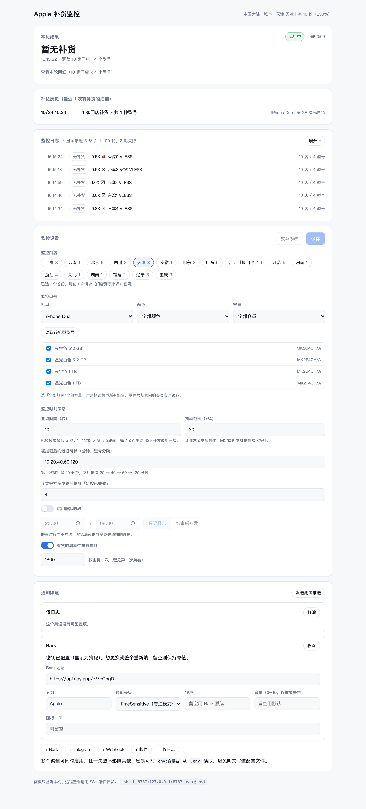

<div align="center">

# 果铺哨兵 · Apple 直营店补货监控（服务器版）

[](https://github.com/LNPANDY/apple-stock-server/actions/workflows/ci.yml)
[](LICENSE)

**盯 Apple 直营店的到店取货库存，有货就推送到你手机；不查询价格、不下单、不付款。**

为长期跑在服务器上设计：实测在 1 核 1G 的 VPS 上稳定运行，
面板与配置全在浏览器里完成，装好后可以一直不去管它。

</div>

---

> **这是什么、不是什么**
> - 监控的是 Apple 直营店（Apple Store）的**到店取货**库存，不是配送库存
> - 收到提醒后，**下单、付款都由你自己在官网完成**——本项目不代购、不结账
> - 与 Apple 无关联。请自行控制请求频率，遵守 Apple 的服务条款
> - 本项目不能帮你预约库存；库存提醒发出后，货可能随时被别人买走

监控运行时的网页面板（真实数据）：



## 它与原项目的关系

本项目是 [`suversal/apple-store-inventory-monitor`](https://github.com/suversal/apple-store-inventory-monitor)（果到雷达，Rust + Tauri 桌面应用）的服务器化改造，按 GPL-3.0 要求以同一许可发布。核心的抗风控经验（真实浏览器会话、`location=` 批量查询、541 处理）都来自原项目的实测积累，详见 [NOTICE](NOTICE)。

原项目需要一台开着桌面的电脑；本项目去掉图形界面和自动结账，换成 Python + 网页面板，让你把它丢到 VPS 上 24 小时跑着，到货了 Bark/Telegram 推到手机。

## 快速开始

### 方式一：一条命令部署到 VPS（推荐）

在你的电脑上执行：

```bash
git clone https://github.com/LNPANDY/apple-stock-server.git
cd apple-stock-server
python3 -m pip install paramiko pyyaml
python3 deploy_to_vps.py 你的VPS_IP
```

部署过程会**逐步询问**：

1. **要不要启用多节点轮换？**（推荐启用——被 Apple 拦截时自动切换节点，是抗风控最有效的手段。需要一个 Clash 订阅，机场后台都能拿到）
2. **要不要配置 Bark 推送？**（Bark App 首页有一个地址，粘贴进来即可）

大约 10–15 分钟后（主要耗时是下载浏览器），它会打印面板地址。浏览器打开，完成。

SSH 密钥要求：本机 `~/.ssh/vps_deploy_key` 能免密登录该 VPS（用 `ssh-copy-id -i ~/.ssh/vps_deploy_key.pub root@IP` 一次性配置）。

### 方式二：本机运行（Mac / Linux 桌面）

```bash
git clone https://github.com/LNPANDY/apple-stock-server.git
cd apple-stock-server
cp config.example.yaml config.yaml
$EDITOR config.yaml        # 至少填 region、pickup、products、notify

./run.sh check -c config.yaml       # 自检：确认能拿到库存
./run.sh run   -c config.yaml --web # 面板 http://127.0.0.1:8787
```

`run.sh` 自动建虚拟环境，不受系统 `python3` 版本影响。

### 方式三：VPS 手动安装

```bash
git clone https://github.com/LNPANDY/apple-stock-server.git
cd apple-stock-server
sudo bash deploy/install.sh          # 装依赖 + 浏览器 + systemd
sudoedit /opt/apple-stock/config.yaml
sudo -u applemon /opt/apple-stock/.venv/bin/python -m app check -c /opt/apple-stock/config.yaml
sudo systemctl enable --now apple-stock
```

## 最小配置

四项就能跑：

```yaml
region: cn                    # cn / hk / mo / tw / jp / sg / au / my

pickup:
  cities: ["上海 上海"]        # 大陆站必须写「省 市」，只写城市会被拒绝

products:
  - part: MJT74CH/A           # 零件号见购买页 URL：/shop/product/MJT74CH/A
    name: iPhone 18 Pro 256GB # 通知里的显示名，可省略

notify:
  - type: bark
    url: env:BARK_URL         # 密钥放 .env，别写进仓库
```

全部配置项说明：[docs/CONFIG.md](docs/CONFIG.md)

## 功能

| 能力 | 说明 |
| --- | --- |
| 一次查全城 | 用 `location=` 而非 `store=`：上海 12 家店只发 1 次请求，而不是 12 次 |
| 失败不等于无货 | 541/403/429/解析失败一律记为「未知」，绝不覆盖上一次的库存结论 |
| 网页面板 | 本轮结果、补货历史、逐轮日志（区分「Apple 拦截」和「节点不通」）、可视化改配置 |
| 出口轮换 | 接入 Clash/mihomo：每轮换节点，被拦时自动冷却切换；订阅链接模式下 12 小时自动更新节点 |
| 监控失效告警 | 连续 N 轮查不到时推送「监控已失效」——静默失效比漏报更危险 |
| 静默时段 | 深夜不推送，可选「结束后合并补发」；按你配置的时区判断，不吃服务器 UTC 的亏 |
| 完整卸载 | 一条命令删干净：服务、程序、防火墙规则、Chromium、apt 库，不影响机器上其他服务 |

## 抗风控：哪些做法有效

这里的每一条都来自实测，不是推测。

| 做法 | 依据 |
| --- | --- |
| 用真实 Chromium 会话查询 | Apple 商品页会先跑浏览器校验；裸 HTTP 客户端即使补齐 UA/Cookie 也会收到自定义状态码 `541` |
| `location=` 批量查询 | 把「每店一请求」压成「每城一请求」，请求量降一个数量级 |
| 节点轮换 | 33 个节点 × 10 秒间隔 = 每个节点约 5 分钟才被用一次；实测 6 小时 1627 轮仅 2% 被拦 |
| 被拦后退避，不硬撞 | 节点冷却 5→10→20→30 分钟；重启进程只会延长封禁 |
| 间隔加抖动 | 固定节奏本身就是机器人特征 |

一个反直觉的经验：**不要用 `gstatic.com` 测速判断节点能不能访问 Apple**。部分机场屏蔽这类探测域名但放行 Apple，实测全超时但 Apple 0.1 秒返回。本项目一律用 Apple 域名做健康检查。

完整设计说明与踩坑记录：[docs/DESIGN.md](docs/DESIGN.md)

## 常见状态

| 面板显示 | 含义 | 会推送吗 |
| --- | --- | --- |
| 无补货 | 查询成功，当前无货 | 否 |
| N 个补货 | 有货，附门店与型号明细 | 是 |
| Apple 拦截（541/403） | 被 Apple 风控拒绝，**不代表无货**；程序会自动退避重试 | 失效超过阈值时推一次 |
| 节点不通 | 该节点自身连不上，程序自动换下一个 | 否 |
| 被限流（429） | 请求过频，程序自动冷却 | 同拦截 |

## 常见问题

**收到 HTTP 541 怎么办？**
不要重启进程。程序会自动退避；调大间隔（单出口建议 ≥300 秒）；如果配了轮换，看是不是个别节点被标记（日志会显示节点名）。

**推送时间差 8 小时？**
已修复。推送与静默时段默认按 `Asia/Shanghai`，可用 `timezone` 配置项改。

**报 `CERTIFICATE_VERIFY_FAILED`？**
本机 Python 缺根证书，不是网络问题。本项目已内置 certifi 兜底；仍遇到时运行 `/Applications/Python\ 3.12/Install\ Certificates.command`。不要用 `verify_ssl=False` 绕过。

更多：[docs/FAQ.md](docs/FAQ.md)

## 与原项目的差异

| 方面 | 果到雷达（原项目） | 本项目 |
| --- | --- | --- |
| 形态 | Rust + Tauri 桌面应用 | Python + 网页面板 |
| 运行环境 | 需要桌面（macOS/Windows/Linux） | 无桌面服务器可跑，实测 1C/1G |
| 自动结账 | 支持（中国大陆） | **移除**——高强度请求会显著提高风控概率 |
| 出口轮换 | Clash API（TCP） | 同左，另支持 Unix socket（ClashVerge）与订阅自动更新 |
| 状态持久化 | 应用配置目录 | 单个 JSON 文件 |
| 卸载 | — | 一条命令完整卸载 |

## 开发

```bash
python -m pip install -r requirements.txt pytest
python -m pytest tests/ -q       # 148 项，全部不需要网络
```

CI 跑 Python 3.10 / 3.11 / 3.12 矩阵——3.10 上 `asyncio.TimeoutError` 与内置
`TimeoutError` 是不同的类，这个坑靠矩阵测试守住。前端在 `app/static/`
（原生 HTML/CSS/JS，无构建步骤）。贡献指引见 [CONTRIBUTING.md](CONTRIBUTING.md)，
其中列有五条「改坏了会出严重问题」的硬性约束。

## 来源与许可

GPL-3.0-or-later。本项目是
[`suversal/apple-store-inventory-monitor`](https://github.com/suversal/apple-store-inventory-monitor)
的衍生作品，必须沿用同一许可；衍生关系与保留的设计详见 [NOTICE](NOTICE)。

监控只读取 Apple 公开页面数据，不登录、不下单。库存随时变化，
**收到提醒不代表一定还能买到**，最终以官网下单结果为准。
